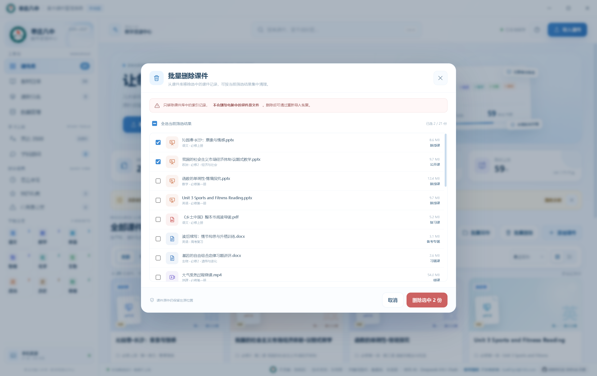
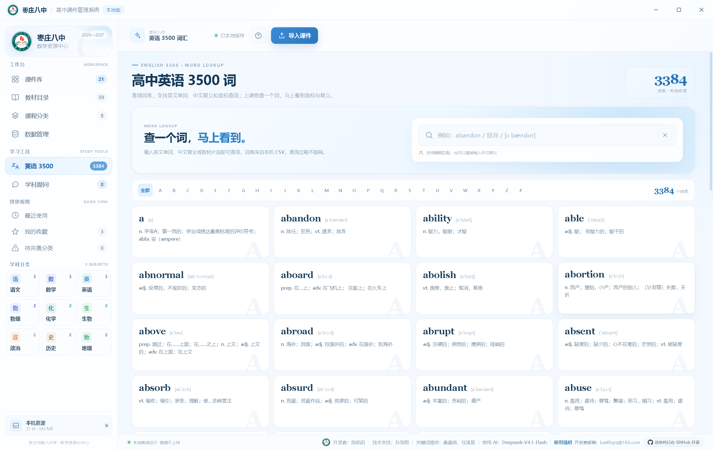
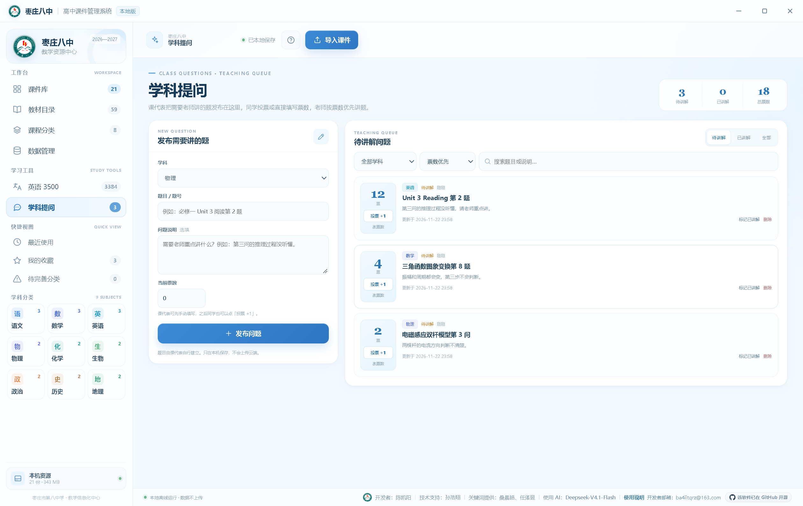
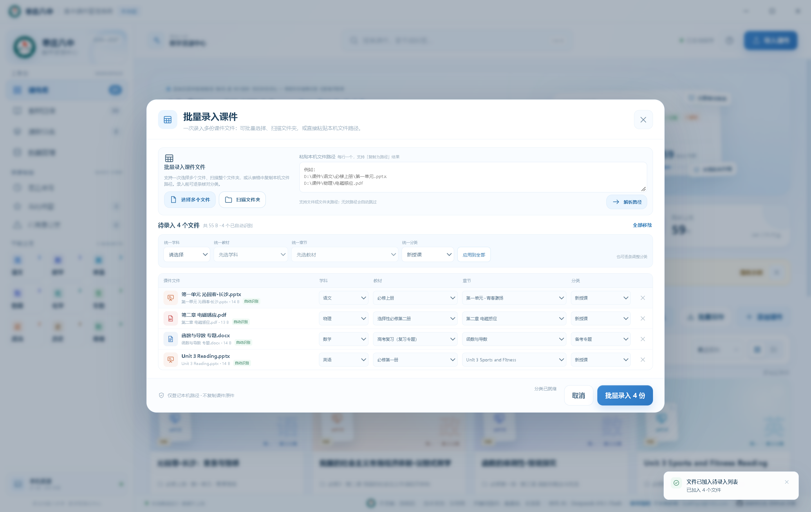
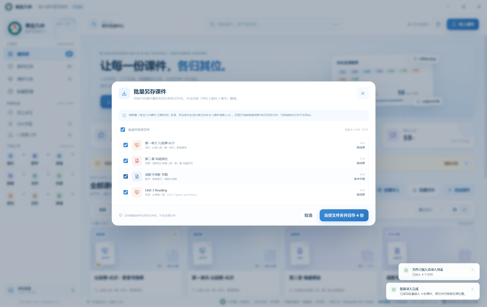
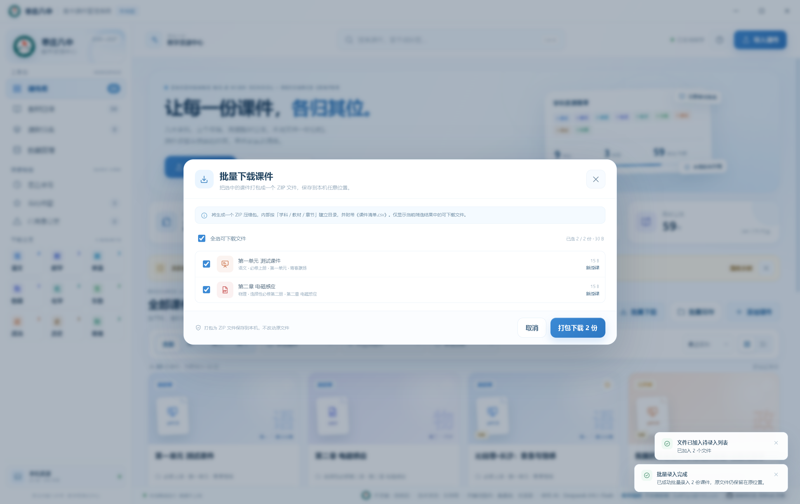

# 枣庄八中 · 高中课件管理系统

**版本：v1.3.0（Windows 安装版）**


一款面向枣庄八中高中教学的本地课件资源整理工具。覆盖九大学科、三个年级的完整教材目录，帮助老师把分散在电脑中的 PPT、Word、PDF、视频、图片等课件，按「学科 → 教材 → 章节 → 课程分类」有序归档。

所有文件都保存在本机，不上传云端；导入时只记录原文件路径，不复制、不移动原文件。

---

## 一、安装与启动

1. 双击 `枣庄八中高中课件管理系统-1.3.0-安装包.exe`。
2. 在安装向导中选择安装位置。默认安装在当前用户目录，也可以点击「浏览」自选路径。
3. 安装程序会自动在**桌面**创建「枣庄八中高中课件管理系统」快捷方式，并在开始菜单创建程序入口。
4. 安装完成后可直接运行。首次启动会自动创建 `data` 数据文件夹，并载入 21 条示例课件，用于熟悉界面。
5. 点击「导入课件」或直接拖入文件 / 文件夹，开始建立自己的课件库。
6. 导入真实课件后，可在首页提示条或「数据管理」中一键清除示例数据。

> 若 Windows 首次运行安装包时出现 SmartScreen 提示，点击「更多信息」→「仍要运行」即可。软件未购买商业代码签名证书，这是 Windows 对未知发布程序的常规提醒。

> 如果安装时提示「不能打开要写入的文件」，请先中止安装，关闭旧版软件或安装程序，删除/改名旧安装目录，或重新运行并选择一个全新的安装位置。也可右键安装包，选择「以管理员身份运行」。从 1.1.0 起已更换默认安装目录并移除了容易触发写入冲突的自定义卸载图标。

### 运行环境

- Windows 10 / Windows 11（64 位）
- 无需安装 Node.js、Python 或其他运行环境
- 建议屏幕分辨率 1366 × 768 及以上
- 打开 PPT / Word / PDF / 视频时，需本机已安装 Microsoft Office、WPS、PDF 阅读器或对应播放器

### 界面右下角

主界面底部右侧固定显示制作团队信息，并提供：

- **使用说明**：打开软件内置操作指南；
- **开发者邮箱**：`ba4iitqrz@163.com`，点击可调用本机邮件客户端，邮箱会同时复制到剪贴板；
- **GitHub 开源标识**：显示「该软件已在 GitHub 开源」。

### 1.3.0 版本新增

- **批量删除**：在课件库按当前筛选结果多选课件，一次移除多条索引记录；**不会删除电脑中的课件原文件**。
- **英语 3500 词汇查询**：左侧「学习工具 → 英语 3500」，离线查询英文单词、音标和中文释义，支持中文/英文模糊搜索和首字母筛选。词库由 `wordlib（main）.csv` 去重整理，共 3384 个词条。
- **学科提问**：左侧「学习工具 → 学科提问」，课代表自行发布题目并填写票数，同学可点「投票 +1」，支持按票数排序、按学科筛选、标记已讲解和删除问题。







### 1.2.0 版本新增

- **批量录入课件**：支持一次选择多个文件、扫描文件夹，或直接粘贴本机文件路径（每行一个），集中核对后批量录入。
- **单个另存**：课件详情中新增「另存为」，把单个课件复制到任意位置。
- **批量另存**：在课件库直接选择多份课件，按「学科 / 教材 / 章节」自动分类复制到目标文件夹，并生成《课件清单.csv》。
- **批量下载**：将选中的多份课件打包成一个 ZIP 文件，内部同样按「学科 / 教材 / 章节」整理，并附带《课件清单.csv》。
- **GitHub 开源标识**：右下角增加开源状态标识。







---

## 二、内置教材目录

系统内置当前高中课程标准常用教材体系，共 **9 大学科、59 个教材/复习专题、349 个章节/专题**：

| 学科 | 教材版本 | 教材与专题 |
|---|---|---|
| 语文 | 统编版 | 必修上、下册，选择性必修上、中、下册，高考复习 |
| 数学 | 人教A版 | 必修第一、二册，选择性必修第一、二、三册，高考复习 |
| 英语 | 人教版 | 必修第一、二、三册，选择性必修第一至四册，高考复习 |
| 物理 | 人教版 | 必修第一至三册，选择性必修第一至三册，高考复习 |
| 化学 | 人教版 | 必修第一、二册，选择性必修1/2/3，高考复习 |
| 生物 | 人教版 | 必修1/2，选择性必修1/2/3，高考复习 |
| 政治 | 统编版 | 必修1—4，选择性必修1/2/3，高考复习 |
| 历史 | 统编版 | 中外历史纲要（上、下），选择性必修1/2/3，高考复习 |
| 地理 | 人教版 | 必修第一、二册，选择性必修1/2/3，高考复习 |

- 其中 50 本为必修/选择性必修教材，另外 9 个为高三复习专题。
- 章节按教材单元、章、课或复习专题整理，兼顾高一、高二、高三三个年级。
- 教材版本、章节顺序和名称可在 `src/catalog.js` 中按学校实际教学计划继续调整后重新打包。
- 若同一本教材在不同年级使用，系统在教材目录中按主要使用年级展示，课件本身不受影响。

---

## 三、功能说明

### 1. 导入本地课件

- 支持「选择文件」「扫描文件夹」，也支持把文件或整个文件夹拖入窗口。
- 课件库标题右侧新增「批量录入」：可一次选择多个文件、扫描文件夹，或粘贴本机文件路径批量识别。
- 单份课件可在详情面板点击「另存为」；多份课件可点击「批量另存」，按分类自动复制并生成清单；也可点击「批量下载」打包为单个 ZIP 文件。
- 文件夹会被递归扫描，自动跳过隐藏目录、临时文件（`~$`）和不支持的文件。
- 系统会根据文件夹层级与文件名，自动识别学科、教材、章节和课程分类：
  - 文件夹中的「语文 / 数学 / 英语…」识别为学科；
  - 「必修一」「必修上册」「选择性必修2」「选必三」等识别为教材；
  - 「第一单元」「第3章」「Unit 4」「第一课」等识别为章节；
  - 「复习」「实验」「微课」「公开课」「试卷」「专题」等关键词识别为课程分类。
- 导入前可逐条校对分类，也可用「统一设置 → 应用到全部」批量设置。
- 单次最多加入 500 个文件；较大的资料请分批整理。
- 文件以「引用路径」方式加入：**不会复制文件，也不占用双份磁盘空间**。

### 2. 分类与检索

- **学科分类**：九大学科独立入口，并显示各学科课件数量。
- **教材目录**：左侧学科、中间教材、右侧章节，三级浏览，点击章节直达该章节课件。
- **课程分类**：新授课、复习课、习题课、实验课、微课、公开课、试卷讲评、备考专题 8 类。
- 支持年级筛选、教材筛选、章节筛选、课程分类筛选，多个条件可叠加。
- 顶部搜索框支持按课件名称、教材、章节、标签、备注、课程分类搜索。
- 支持收藏、最近使用、待完善分类等快捷视图。
- 支持卡片/列表两种视图，以及按最近添加、最早添加、名称、文件大小排序。

### 3. 课件详情

点击任意课件卡片打开右侧详情面板：

- 预览图片、PDF、视频、音频；
- 一键「打开原文件」或「在文件夹中显示」；
- 修改所属学科、教材、章节、课程分类；
- 添加标签和教学备注；
- 收藏课件或移除记录。

Office 文档（PPT、Word、Excel）不内嵌预览，点击「打开原文件」会调用本机 Office / WPS 打开。移除记录只删除索引，**不会删除电脑中的原文件**。

### 4. 数据管理与安全

- 数据索引位置：可通过「数据管理 → 打开数据文件夹」查看；通常为程序目录下的 `data\courseware-library.json`。
- 「导出课件清单」：生成 CSV 表格，可用 Excel 打开。
- 「导出数据备份」：导出 JSON 分类索引和学科提问，不包含课件原文件。
- 「从备份恢复」：恢复分类、备注和文件路径索引；不会修改原文件。
- 「清除示例数据」「清空课件库」：只清理索引，不删除原文件。
- 如果课件被移动或删除，系统会在启动检测时标记「文件缺失」，重新导入即可。
- 打开软件时支持文件缺失检测；文件大小变化会自动同步。

### 5. 英语 3500 词汇查询

- 在左侧「学习工具 → 英语 3500」进入词汇页，不需要打开 Python。
- 支持按英文单词、中文释义或音标片段模糊查询，例如输入 `abandon`、`放弃` 或 `əˈbændən`。
- 可点击 A—Z 首字母快速浏览，点击「显示更多单词」继续加载。
- 词库由 `wordlib（main）.csv` 清理、去重后离线内置，共 3384 个词条；查询过程不联网。
- 词条包含单词、音标和中文释义；原始 CSV 中的搭配/考点列为空时，页面只展示已有字段。

### 6. 学科提问与投票

- 在左侧「学习工具 → 学科提问」进入提问页。
- 课代表选择学科，自行填写题目/题号、问题说明和当前票数，点击「发布问题」。
- 每道题可点「投票 +1」实时加票；点「改票数」可手动输入票数，适合课代表统计后录入。
- 右侧默认按「票数优先」展示待讲解问题，也可切换「最新发布 / 最早发布」。
- 支持按学科筛选、按题目或说明搜索。
- 老师讲完一道题后可点「标记已讲解」，该题移到「已讲解」；也可以「重新打开」或删除。
- 提问和票数保存在本机 `courseware-library.json` 中，不会上传云端。

### 7. 批量删除

- 在课件库标题右侧点击「批量删除」，会列出当前筛选结果中的所有课件。
- 勾选需要移除的记录（可全选当前筛选结果），点击「删除选中」。
- **只删除课件库索引，不会删除电脑中的课件原文件**；需要时可重新导入。
- 删除后，相关分类、标签、备注和收藏状态也会一并移除。

### 8. 隐私说明

- 软件完全离线运行，不发起任何业务网络请求，不上传课件、路径、备注或使用数据。
- 数据仅保存在本机。
- 首次启动的示例课件只是界面演示，不包含真实文件，可随时清除。

---

## 四、数据备份与迁移

因为课件原件保留在原文件夹中，建议这样备份：

1. **课件原件**：继续由电脑磁盘 / 学校网盘 / 移动硬盘备份。
2. **分类索引与提问**：退出软件后，复制 `data\courseware-library.json`，或在软件内「数据管理 → 导出数据备份」。备份会包含课件索引和学科提问。
3. **整机迁移**：把课件原文件夹和 `courseware-library.json` 一起迁移，保持原路径不变；若路径发生变化，重新导入对应文件夹即可。

> `data` 文件夹中的 `.runtime` 子文件夹是软件运行缓存。日常备份只需要 `data\courseware-library.json`；若希望连缓存一起迁移，也可以复制整个 `data` 文件夹。

---

## 五、卸载

1. 建议先在「数据管理」中导出数据备份。
2. 退出软件。
3. 在 Windows「设置 → 应用 → 已安装的应用」中找到并卸载；或运行安装目录中的卸载程序。
4. 电脑中的任何课件原文件都不会受影响。

> `data` 文件夹中保存的是课件索引与分类，不含课件原件。需要保留分类记录时，请提前备份 `courseware-library.json`。

---

## 六、常见问题

**Q：导入后为什么找不到原文件？**  
A：如果导入后又移动、重命名或删除了原文件，索引会失效并标记「文件缺失」。把文件放回原路径，或重新导入新位置。

**Q：软件会复制课件吗？**  
A：不会。系统只保存文件路径和分类信息。原始课件仍然只占一份磁盘空间。

**Q：能打开 PPT / Word 吗？**  
A：可以调用本机默认 Office/WPS 打开，但软件本身不做 Office 内嵌预览。PDF、图片、视频、音频可直接预览。

**Q：软件联网吗？**  
A：不联网。全部数据保存在本机。

**Q：示例数据怎么清除？**  
A：首页提示条点击「清除示例」，或在「数据管理 → 清除示例数据」中操作。

**Q：安装时可以自己选目录吗？**  
A：可以。安装向导会显示安装位置页面，可点击「浏览」选择任意有写入权限的目录。

**Q：怎么打开使用说明？**  
A：点击界面右下角状态栏中的「使用说明」，或点击右上角的问号按钮。

**Q：数据文件夹可以放到别处吗？**  
A：软件启动时会在程序同目录创建 `data`。若该目录不可写，会自动回退到 Windows 用户数据目录；可通过「数据管理 → 打开数据文件夹」查看实际位置。

---

## 七、制作团队

- 开发者：陈凯阳
- 技术支持：孙浩翔
- 关键词提供：桑晨皓、任泽昱
- 使用 AI：Deepseek-V4.1-Flash
- 开发者邮箱：`ba4iitqrz@163.com`
- 开源状态：该软件已在 GitHub 开源

---

## 八、给维护者

源码结构：

```
zzbz-courseware/
├─ main.js                     Electron 主进程：文件扫描、本地 IPC、窗口、预览协议
├─ preload.js                  安全的渲染进程 API 桥
├─ src/
│  ├─ index.html               界面结构
│  ├─ styles.css               浅蓝色视觉样式
│  ├─ catalog.js               九大学科／教材／章节数据
│  ├─ icons.js                 内联 SVG 图标
│  ├─ detect.js                文件名与文件夹自动分类
│  ├─ app.js                   界面逻辑
│  └─ mock.js                  浏览器预览模式（仅 ?mock=1）
├─ assets/
│  ├─ icon.ico                 由校徽生成的应用图标
│  ├─ school-badge.png         抠图后的透明校徽
│  └─ school-badge-source.jpg  校徽原图
├─ scripts/
│  ├─ make_badge.py            校徽抠图脚本
│  ├─ make_icon_badge.py       由校徽生成应用图标
│  ├─ build-installer.mjs      生成 Windows 安装包
│  ├─ build-portable.mjs       生成绿色便携版（可选）
│  └─ e2e.mjs                  CDP 自动化验收脚本
└─ package.json                构建配置
```

常用命令：

```powershell
npm install
npm start              # 开发运行
npm run dist           # 生成 Windows 安装包（带桌面快捷方式）
npm run dist:portable  # 生成绿色便携版（可选）
```

维护教材目录：编辑 `src/catalog.js` 中的 `SUBJECTS` 与 `COURSE_TYPES`，教材会被自动分配 ID；如新增学科需同时维护 `detect.js` 中的识别关键词。

兼容性说明：为兼容启用了严格 AppContainer 策略的部分 Windows 环境，安装包创建的桌面/开始菜单快捷方式会自动追加 `--no-sandbox` 参数。软件完全离线，只加载内置界面与本机文件。若学校终端允许 Chromium 沙箱，可在 `scripts/build-installer.mjs` 中调整快捷方式参数后重新打包。

> 安装包会同时安装 `使用说明.txt`。如需分发，只需分发安装包与本说明文件，不要分发开发机上的 `data`。

---

枣庄市第八中学 · 教学信息化中心  
本地软件版 v1.3.0
